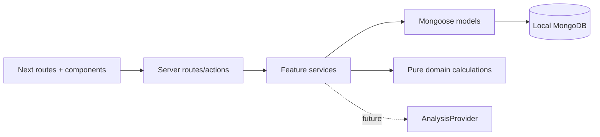

# High-level design

Next.js App Router serves the UI and server endpoints. Domain calculations are pure TypeScript. Mongoose owns persistence and all user-owned documents carry `userId`; Phase 1 resolves the local owner server-side.

Keep client components limited to interaction. Pino logs server failures without secrets. Future AI is an adapter behind `AnalysisProvider`, with deterministic metrics prepared before invocation, validated structured output, caching by source-data hash, and usage logging. Deployment assumes Linux host plus Docker Compose MongoDB bound to loopback.
